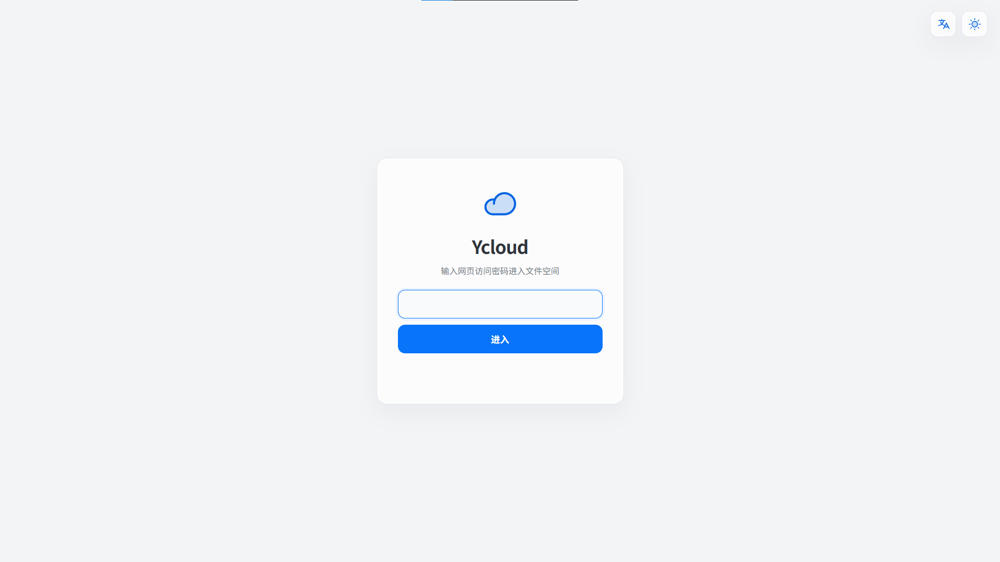
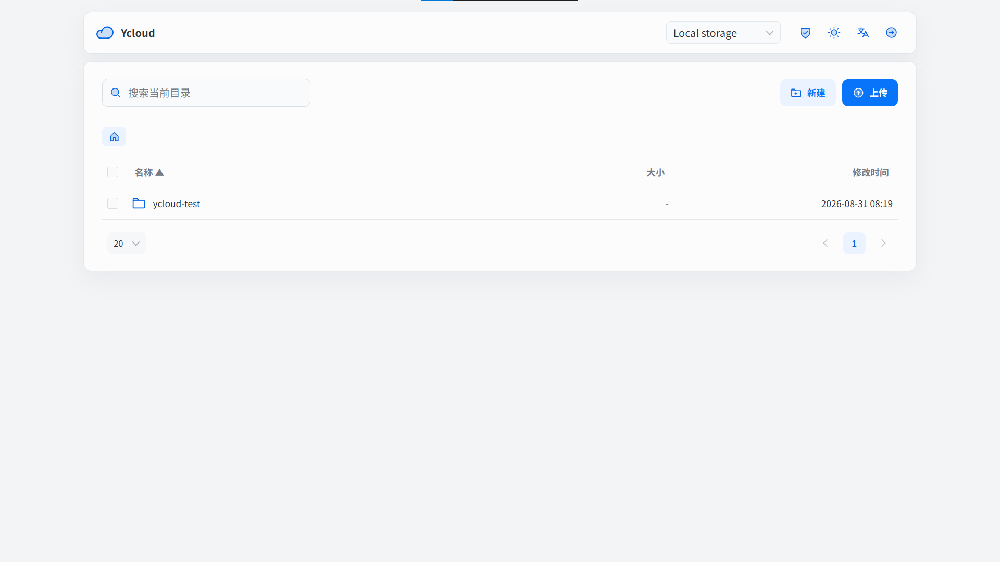
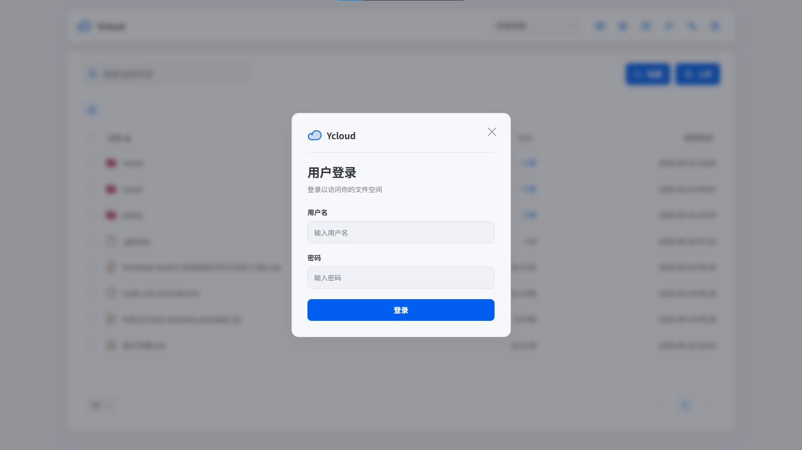
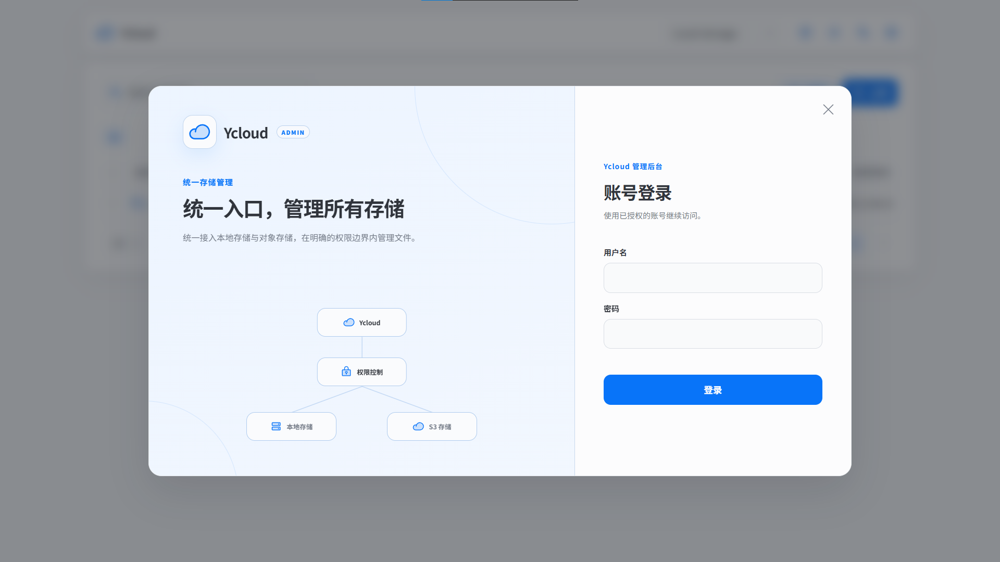
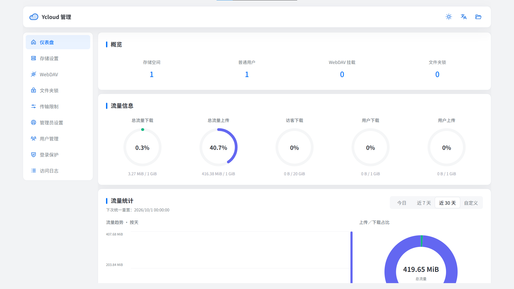

# Ycloud

English | [简体中文](README.zh-CN.md)

A self-hosted file manager built with Rust and Vue, with local storage and S3-compatible object storage.

## Features

- Local storage, Alibaba Cloud OSS, Tencent Cloud COS, MinIO, RustFS, and other S3-compatible services.
- File/folder uploads, downloads, previews, search, move, copy, rename, delete, ZIP archives, and an image gallery.
- Separate access rules for administrators, guests, user accounts, and WebDAV mounts.
- Password-protected folders, TOTP, login protection, access logs, and transfer limits.
- Direct S3 uploads from the browser, streaming relay uploads, atomic local writes, and automatic recovery of interrupted uploads.

Browser uploads save same-name files with numbered suffixes; WebDAV retains overwrite semantics. Administrators create user accounts. The user icon opens user sign-in; the shield opens admin sign-in. Each account has one active browser session: signing in again replaces its previous session.

See [Backend design and maintenance](docs/backend-design.md) for commit boundaries, recovery rules, and implementation details.

## Screenshots

<table>
  <tr>
    <th>Site access</th>
    <th>File browser</th>
  </tr>
  <tr>
    <td></td>
    <td></td>
  </tr>
  <tr>
    <th>User sign-in</th>
    <th>Administrator sign-in</th>
  </tr>
  <tr>
    <td></td>
    <td></td>
  </tr>
</table>

Admin dashboard:



## Development and builds

- Rust and Cargo: `rust-toolchain.toml` pins Rust 1.96.1. Install the native build tools for your platform.
- Node.js: `^20.19.0` or `>=22.12.0`; npm: 11.17.0. Frontend dependencies are pinned in `frontend/package-lock.json`.
- Container deployments also need Docker Engine and the Compose plugin.

From the repository root, build the frontend before the backend. Rust embeds the files in `static/app/` into the executable:

```bash
cd frontend
npm ci
npm run build
cd ..
cargo build --release --locked
```

The executable is `target/release/ycloud`, or `ycloud.exe` on Windows. After changing the frontend, rebuild and commit the entire `static/app/` directory, including its chunks and generated `embedded-assets.rs`. Copying only the entry-point JavaScript is not enough.

For development, run `cargo run --locked` from the repository root and `npm run dev` from `frontend/` in another terminal. Open `http://127.0.0.1:5173`. Vite forwards API requests to `127.0.0.1:18473` by default. Initial credentials are written to `initial-credentials.json` in the working directory; do not commit that file.

## Docker Compose

From the repository root:

```bash
mkdir -p data storage
sudo chmod 700 data
docker compose up -d --build
docker compose ps
```

The first start creates accounts and configuration, but does not add storage. Sign in to the admin console and add local or S3 storage. Removing a storage configuration does not delete its files. The file browser lists storage according to permissions and remembers each account's last manually selected storage.

Open `http://<server-ip>:18473`. Read the initial credentials:

```bash
sudo cat ./data/initial-credentials.json
```

The credentials file is removed after you change both the administrator password and the site access password. With separate mounts, `./data` holds configuration, the master key, and runtime state; `./storage` holds local files. Back up both. With only a `./data` mount, local files use its `storage/` subdirectory by default.

The container runs as root by default; it does not enforce a UID or GID. To use another account, set `user: "UID:GID"` in Compose and give that account read and write access to the data directory. For example, a new, empty directory can use `sudo chown 1000:1000 data` with `user: "1000:1000"`. Back up existing data and check ownership and NAS ACLs before changing permissions recursively.

You can set `stop_grace_period: 60s` in Compose, or allow longer, such as `5m`, for large transfers. Stop the service after transfers finish where possible. Without an explicit setting, Docker waits 10 seconds before forcing termination. A longer wait does not guarantee that every task will finish.

Container stdout logs follow the Docker daemon's logging configuration unless overridden in Compose. This does not limit application access logs in the data directory. Recreate existing containers to apply new logging settings.

### Docker without Compose

Build and start from the repository root:

```bash
docker build --tag ycloud:local .
mkdir -p data
sudo chmod 700 data
docker run -d --name ycloud --restart unless-stopped \
  -p 18473:18473 \
  --mount type=bind,src="$(pwd)/data",dst=/var/lib/ycloud \
  ycloud:local
```

Add `--user UID:GID` or `--stop-timeout 60` before the image name to choose the runtime account or shutdown wait. The data directory and initial credentials work the same way as with Compose.

## Run directly on Linux

After building, run from the repository root:

```bash
BIND_ADDRESS=0.0.0.0 ./target/release/ycloud
```

By default, configuration is stored in `config.json` and local storage uses `storage/` in the working directory.

`config.example.json` documents the configuration format; it is not a ready-to-run configuration. Its password hash is a placeholder. On a new installation, start Ycloud with no existing file at `CONFIG_PATH` (or the default `config.json`) to generate the configuration and `initial-credentials.json`. Use the admin console to change settings; do not copy the example over an existing configuration.

## Deployment settings

| Variable | Purpose |
| --- | --- |
| `BIND_ADDRESS` | Listening address; defaults to `127.0.0.1` outside the container |
| `PORT` | HTTP port; defaults to `18473` |
| `CONFIG_PATH` | Configuration file path |
| `STORAGE_PATH` | Local path available for administrators to add as storage |
| `ALLOWED_HOSTS` | Allowed internal Host values, separated by commas |
| `LOCAL_STORAGE_MOUNTS` | JSON array of local mount points available in the admin console |
| `RUST_LOG` | Log level |

The Dockerfile sets the container's listening address, port, and data paths. A normal Compose deployment does not need additional access-mode settings.

Behind a reverse proxy, enter its connection-source IP under **Domain binding → Trusted proxy IP**; changes take effect immediately. Separate addresses with commas; an empty list trusts no forwarded headers. The proxy must overwrite `X-Real-IP`. Keep the backend port accessible only to the proxy where possible.

### Configuration master key

Ycloud generates a master key and stores it in the data directory. Container deployments or external key management can use `YCLOUD_CONFIG_KEY_FILE`; `YCLOUD_CONFIG_KEY` can override it. The key is 32 random bytes encoded as URL-safe Base64. Losing it makes encrypted S3 SecretKeys and TOTP secrets unrecoverable.

### Storage

Changing a connection, restricting access, or disabling storage may interrupt active transfers. The backend handles unfinished uploads automatically. Do not repeat an upload while its result is awaiting confirmation. Removing storage does not delete files, but you must first remove references from WebDAV mounts, folder locks, and account permissions.

Guest access controls browser access without an account. WebDAV uses its own mount credentials and read/write permissions.

WebDAV shares the single-file size limit, site-wide traffic quota, and global transfer rates (`0` means unlimited rate). It supports Depth 0/1 directory listings and single-Range downloads, but not recursive listings, locks, or resumable uploads. Downloads use attachment responses. A timeout does not prove failure: check the destination before uploading again. See [Backend design](docs/backend-design.md) for protocol and conditional-write boundaries.

Example of an additional local mount:

```env
LOCAL_STORAGE_MOUNTS=[{"id":"archive","name":"Archive","path":"/srv/ycloud/archive"}]
```

For self-hosted S3 services such as MinIO or RustFS, enter the Endpoint, Bucket, and access keys in the admin console. No endpoint allowlist is required. Endpoints must be HTTP(S) addresses without embedded credentials, a path, or a query string. HTTP is available on trusted internal networks; use HTTPS on untrusted networks.

Direct uploads require a browser-accessible Endpoint and bucket CORS allowing `PUT` from the Ycloud site's origin with request headers `*`. HTTPS sites need HTTPS storage endpoints. Access keys stay on the server; browsers receive temporary upload URLs.

Enable relay uploads if only the server can reach storage. New S3 connections default to direct uploads; existing connections keep their mode. Direct-upload failures do not automatically switch to relay. Direct payloads bypass Ycloud's rate limits and traffic quotas; permissions, file-size and storage-capacity limits still apply. Relayed uploads and downloads are counted as server traffic.

Use the official HTTPS endpoint for the bucket's Region with Alibaba Cloud OSS and Tencent Cloud COS. Only one Ycloud instance may write to a given Bucket/Prefix.

Configure an incomplete-multipart-upload lifecycle rule in the bucket console to remove empty sessions left by lost creation responses. Ycloud does not change bucket lifecycle rules.

### Deployment limits

The admin console can change application limits, but cannot exceed these deployment limits:

- `MAX_UPLOAD_BYTES`
- `MAX_UPLOAD_BATCH_BYTES`
- `MAX_UPLOAD_BATCH_ENTRIES`
- `MAX_ARCHIVE_BYTES`
- `MAX_ARCHIVE_ENTRIES`

On first start, each application default is the lower of its built-in default and the deployment limit. Existing configurations are not reduced automatically. Upload and archive byte limits must be at least 1 MiB; the batch byte limit must be at least the single-file upload limit.

Admin **Transfer limits → File upload concurrency** sets simultaneous files (1–32, default 4). S3 direct uploads use the same per-account limit across pages, with at most 32 active files globally. Lowering the setting does not cancel active transfers. WebDAV and S3 per-file part concurrency are unchanged. See [Configuration limits](docs/admin-configuration-audit.zh-CN.md) (Chinese) for parameter bounds.

## Checks

```bash
cargo fmt --all -- --check
cargo clippy --all-targets --all-features --locked -- -D warnings
cargo test --all-targets --locked

cd frontend
npm run check
```

## Traffic quotas and accounting

- **Quotas:** site-wide, shared guest downloads, shared user-account traffic, and per-account traffic. Uploads and downloads are separate; `0` means unlimited.
- **Accounting:** only file bytes passing through the server count; direct S3 uploads and direct-link downloads do not. Relayed downloads, previews, and archives count. Administrator relay traffic is counted but quota-exempt; independent WebDAV mounts use the site-wide quota. Disabling quotas does not disable accounting. This is not a network-interface traffic meter.
- **Upgrades:** existing usage is retained; historical direct traffic cannot be reliably subtracted.
- **Resets and backups:** quotas reset on hourly, daily, or monthly cycles. Restarts do not reset usage. Stop the service before backing up, and save the configuration together with `traffic-usage.json` and `traffic-usage.jsonl`.

### Diagnose a damaged ledger

A damaged traffic ledger does not reset usage or disable quota enforcement. Stop the service, back up the ledger, and run `ycloud doctor traffic` with the same `CONFIG_PATH`. This is a read-only check: it does not repair the ledger or create files. Restore corrupt complete records or sequence gaps from a trusted backup. Do not delete the ledger and start over.

## Open-source components

Ycloud uses Vue, Phosphor Icons, Reka UI, Tokio, Axum, the AWS SDK for Rust, and other open-source components. See [Third-party notices](THIRD_PARTY_NOTICES.md) for the component list and required license texts.
